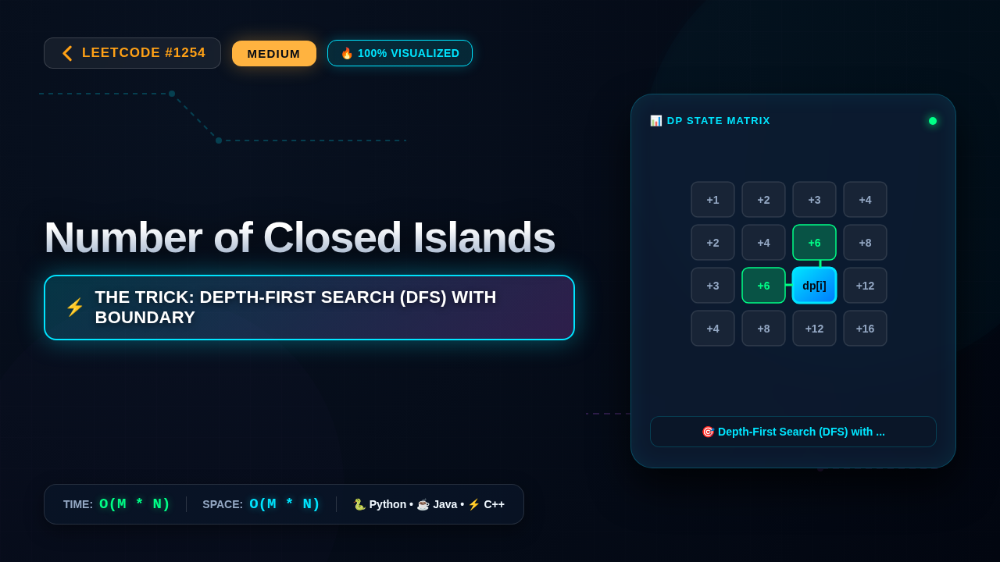

# 1254. Number of Closed Islands

### 📺 Video Walkthrough & Visual Execution

👉 **[Watch the complete step-by-step visual explanation on YouTube](https://www.youtube.com/watch?v=am8a4yBQkZI)**

## 💻 Solutions in 5 Major Languages

| Language | Solution File |
|---|---|
| 🐍 **Python 3** | [`solution.py`](solution.py) |
| ☕ **Java** | [`Solution.java`](Solution.java) |
| ⚡ **C++** | [`solution.cpp`](solution.cpp) |
| 🟨 **JavaScript** | [`solution.js`](solution.js) |
| 🐹 **Go** | [`solution.go`](solution.go) |

## 📝 Problem Statement

Given a 2D 
grid
 consists of 
0s
 (land) and 
1s
 (water).  An 
island
 is a maximal 4-directionally connected group of 
0
s
 and a 
closed island
 is an island 
totally
 (all left, top, right, bottom) surrounded by 
1s.

Return the number of 
closed islands
.

## 💡 Approach: Depth-First Search (DFS) with Boundary Flooding

To find all closed islands, we first eliminate any landmasses (0s) that touch the boundary of the grid. Any island connected to the border cannot be a closed island because it is not completely surrounded by water (1s). We can use Depth-First Search (DFS) to flood-fill and mark all boundary-connected 0s as 1s. After clearing the boundary-connected components, any remaining 0s in the grid are guaranteed to be part of closed islands. We then iterate through the grid, and for each unvisited 0, we perform a DFS to count and sink the entire closed island.

## ⏱️ Complexity

- **Time Complexity:** `O(M * N)`
- **Space Complexity:** `O(M * N)`
