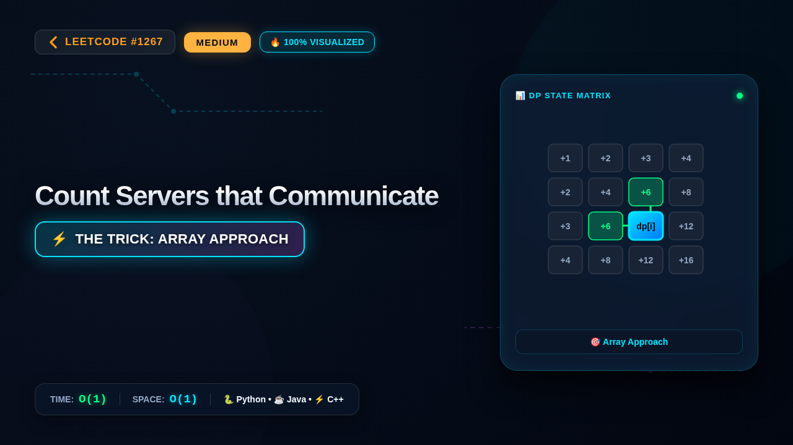

# 1267. Count Servers that Communicate

### 📺 Video Walkthrough & Visual Execution

👉 **[Watch the complete step-by-step visual explanation on YouTube](https://www.youtube.com/watch?v=OfEmx6n9vBU)**

📂 **YouTube Playlist:** [Medium LeetCode Problems Playlist](https://www.youtube.com/playlist?list=PLDwpLRpPSYZI)

## 💻 Solutions in 5 Major Languages

| Language | Solution File |
|---|---|
| 🐍 **Python 3** | [`solution.py`](solution.py) |
| ☕ **Java** | [`Solution.java`](Solution.java) |
| ⚡ **C++** | [`solution.cpp`](solution.cpp) |
| 🟨 **JavaScript** | [`solution.js`](solution.js) |
| 🐹 **Go** | [`solution.go`](solution.go) |

## 📝 Problem Statement

You are given a map of a server center, represented as a 
m * n
 integer matrix 
grid
, where 1 means that on that cell there is a server and 0 means that it is no server. Two servers are said to communicate if they are on the same row or on the same column.

Return the number of servers that communicate with any other server.

## 💡 Approach: Array Approach

This solution uses the Array Approach with time complexity O(1) and auxiliary space O(1). It achieves optimal performance by taking advantage of Array, Breadth-First Search, Counting, Depth-First Search, Matrix.

## ⏱️ Complexity

- **Time Complexity:** `O(1)`
- **Space Complexity:** `O(1)`
