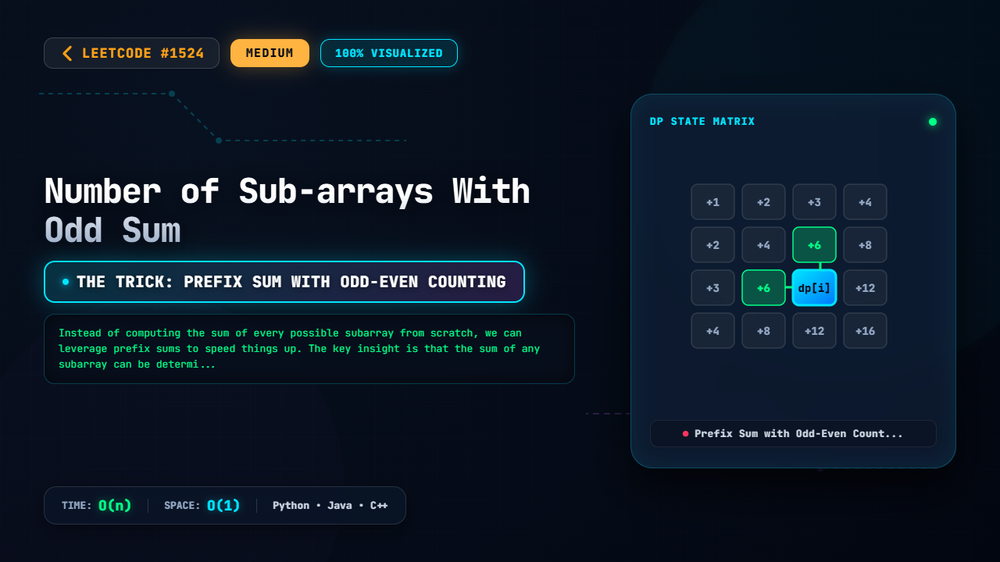

# 1524. Number of Sub-arrays With Odd Sum

### 📺 Video Walkthrough & Visual Execution

👉 **[Watch the complete step-by-step visual explanation on YouTube](https://www.youtube.com/watch?v=AbeRIVF4dfQ)**

📂 **YouTube Playlist:** [Medium LeetCode Problems Playlist](https://www.youtube.com/playlist?list=PLDwpLRpPSYZI)

## 💻 Solutions in 5 Major Languages

| Language | Solution File |
|---|---|
| 🐍 **Python 3** | [`solution.py`](solution.py) |
| ☕ **Java** | [`Solution.java`](Solution.java) |
| ⚡ **C++** | [`solution.cpp`](solution.cpp) |
| 🟨 **JavaScript** | [`solution.js`](solution.js) |
| 🐹 **Go** | [`solution.go`](solution.go) |

## 📝 Problem Statement

Given an array of integers 
arr
, return 
the number of subarrays with an 
odd
 sum
.

Since the answer can be very large, return it modulo 
10
9
 + 7
.

## 💡 Approach: Prefix Sum Parity

The sum of a subarray arr[i:j+1] can be calculated as prefix_sum[j+1] - prefix_sum[i]. We are interested in the parity of this sum. The parity of a difference (A - B) is odd if and only if A and B have different parities. Therefore, we need to count pairs (i, j) such that prefix_sum[j+1] and prefix_sum[i] have different parities. We can iterate through the array, maintaining the current prefix sum's parity. For each element, we update the prefix sum's parity. If the current prefix sum parity is odd, it means any subarray ending at the current index with an even prefix sum before it will have an odd sum. Similarly, if the current prefix sum parity is even, any subarray ending at the current index with an odd prefix sum before it will have an odd sum. We can maintain counts of how many times we've seen an even prefix sum and an odd prefix sum so far. Let `even_count` be the number of prefix sums encountered so far that are even, and `odd_count` be the number of prefix sums encountered so far that are odd. When we are at index `k` and the prefix sum up to `k` (inclusive) has parity `P`, we want to find how many previous prefix sums (including the prefix sum of 0 before the array starts) have parity `1-P`. If `P` is odd, we add `even_count` to our total. If `P` is even, we add `odd_count` to our total. We then update `even_count` or `odd_count` based on the current prefix sum's parity. The initial prefix sum (before any elements) is 0, which is even, so we initialize `even_count` to 1 and `odd_count` to 0. The modulo operation should be applied at each addition to prevent overflow.

## ⏱️ Complexity

- **Time Complexity:** `O(n)`
- **Space Complexity:** `O(1)`
