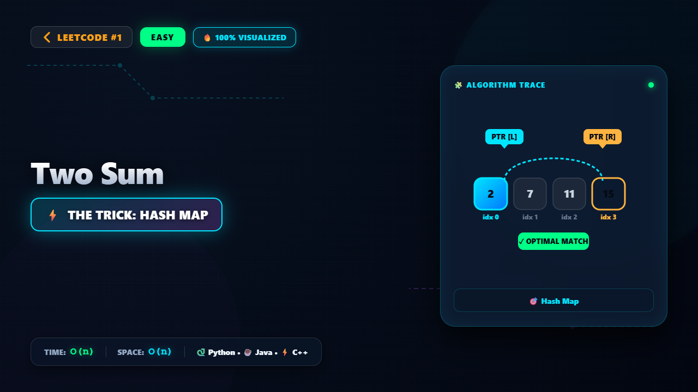

# 1. Two Sum

### 📺 Video Walkthrough & Visual Execution

👉 **[Watch the complete step-by-step visual explanation on YouTube](https://www.youtube.com/watch?v=Y6z5gja64Ro)**

## 💻 Solutions in 5 Major Languages

| Language | Solution File |
|---|---|
| 🐍 **Python 3** | [`solution.py`](solution.py) |
| ☕ **Java** | [`Solution.java`](Solution.java) |
| ⚡ **C++** | [`solution.cpp`](solution.cpp) |
| 🟨 **JavaScript** | [`solution.js`](solution.js) |
| 🐹 **Go** | [`solution.go`](solution.go) |

## 📝 Problem Statement

You are given an array of integers 
nums
 and an integer 
target
, return 
indices of the two numbers such that they add up to 
target
.

You may assume that each input would have 
exactly
 one solution
, and you may not use the 
same
 element twice.

You can return the answer in any order.

## 💡 Approach: Hash Map

Instead of checking every possible pair using nested loops which takes O(n^2) time, we can iterate through the array once and use a hash map to store the values we have seen so far along with their indices. For each element, we calculate its complement (target - current_element) and check if the complement already exists in our hash map. If it does, we immediately found our two numbers and can return their indices.

## ⏱️ Complexity

- **Time Complexity:** `O(n)`
- **Space Complexity:** `O(n)`
