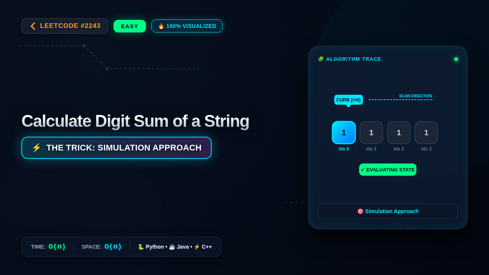

# 2243. Calculate Digit Sum of a String

### 📺 Video Walkthrough & Visual Execution

👉 **[Watch the complete step-by-step visual explanation on YouTube](https://www.youtube.com/watch?v=_Gm1WwHHxIs)**

📂 **YouTube Playlist:** [Easy LeetCode Problems Playlist](https://www.youtube.com/playlist?list=PLO_wgoXxiqtY)

## 💻 Solutions in 5 Major Languages

| Language | Solution File |
|---|---|
| 🐍 **Python 3** | [`solution.py`](solution.py) |
| ☕ **Java** | [`Solution.java`](Solution.java) |
| ⚡ **C++** | [`solution.cpp`](solution.cpp) |
| 🟨 **JavaScript** | [`solution.js`](solution.js) |
| 🐹 **Go** | [`solution.go`](solution.go) |

## 📝 Problem Statement

You are given a string 
s
 consisting of digits and an integer 
k
.

A 
round
 can be completed if the length of 
s
 is greater than 
k
. In one round, do the following:

Divide
 
s
 into 
consecutive groups
 of size 
k
 such that the first 
k
 characters are in the first group, the next 
k
 characters are in the second group, and so on. 
Note
 that the size of the last group can be smaller than 
k
.

Replace
 each group of 
s
 with a string representing the sum of all its digits. For example, 
"346"
 is replaced with 
"13"
 because 
3 + 4 + 6 = 13
.

Merge
 consecutive groups together to form a new string. If the length of the string is greater than 
k
, repeat from step 
1
.

Return 
s
 
after all rounds have been completed
.

## 💡 Approach: Simulation Approach

This solution uses the Simulation Approach with time complexity O(n) and auxiliary space O(n). It achieves optimal performance by taking advantage of Simulation, String.

## ⏱️ Complexity

- **Time Complexity:** `O(n)`
- **Space Complexity:** `O(n)`
