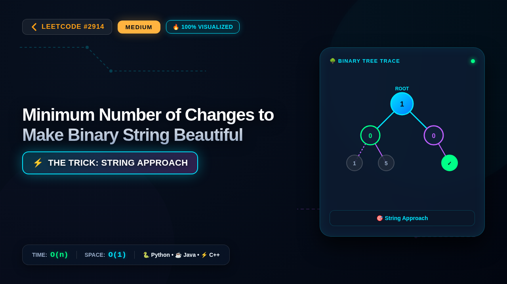

# 2914. Minimum Number of Changes to Make Binary String Beautiful

### 📺 Video Walkthrough & Visual Execution

👉 **[Watch the complete step-by-step visual explanation on YouTube](https://www.youtube.com/watch?v=k29dhsYoz-A)**

📂 **YouTube Playlist:** [Medium LeetCode Problems Playlist](https://www.youtube.com/playlist?list=PLDwpLRpPSYZI)

## 💻 Solutions in 5 Major Languages

| Language | Solution File |
|---|---|
| 🐍 **Python 3** | [`solution.py`](solution.py) |
| ☕ **Java** | [`Solution.java`](Solution.java) |
| ⚡ **C++** | [`solution.cpp`](solution.cpp) |
| 🟨 **JavaScript** | [`solution.js`](solution.js) |
| 🐹 **Go** | [`solution.go`](solution.go) |

## 📝 Problem Statement

You are given a 
0-indexed
 binary string 
s
 having an even length.

A string is 
beautiful
 if it's possible to partition it into one or more substrings such that:

Each substring has an 
even length
.

Each substring contains 
only
 
1
's or 
only
 
0
's.

You can change any character in 
s
 to 
0
 or 
1
.

Return 
the 
minimum
 number of changes required to make the string 
s
 
beautiful
.

## 💡 Approach: String Approach

This solution uses the String Approach with time complexity O(n) and auxiliary space O(1). It achieves optimal performance by taking advantage of String.

## ⏱️ Complexity

- **Time Complexity:** `O(n)`
- **Space Complexity:** `O(1)`
