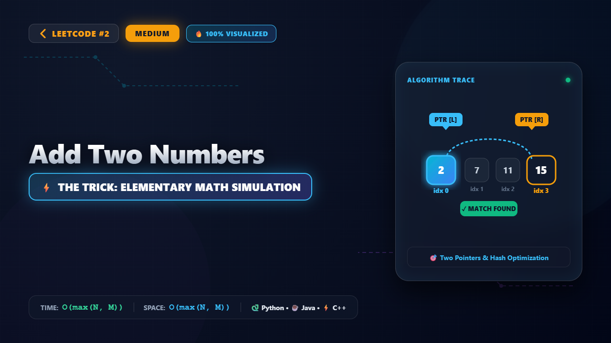

# 2. Add Two Numbers

### 📺 Video Walkthrough & Visual Execution

## 💻 Solutions in 5 Major Languages

| Language | Solution File |
|---|---|
| 🐍 **Python 3** | [`solution.py`](solution.py) |
| ☕ **Java** | [`Solution.java`](Solution.java) |
| ⚡ **C++** | [`solution.cpp`](solution.cpp) |
| 🟨 **JavaScript** | [`solution.js`](solution.js) |
| 🐹 **Go** | [`solution.go`](solution.go) |

## 📝 Problem Statement

You are given two 
non-empty
 linked lists representing two non-negative integers. The digits are stored in 
reverse order
, and each of their nodes contains a single digit. Add the two numbers and return the sum as a linked list.

You may assume the two numbers do not contain any leading zero, except the number 0 itself.

## 💡 Approach: Elementary Math Simulation

We can simulate the addition of two numbers digit by digit, exactly like how we do it on paper from right to left. Since the digits are already stored in reverse order in the linked lists, the head of each list represents the least significant digit (ones place). We can iterate through both lists simultaneously, adding corresponding digits along with any carry from the previous position. If one list is shorter than the other, we treat its missing digits as 0. We continue this process until both lists are fully traversed and there is no remaining carry.

## ⏱️ Complexity

- **Time Complexity:** `O(max(N, M))`
- **Space Complexity:** `O(max(N, M))`
