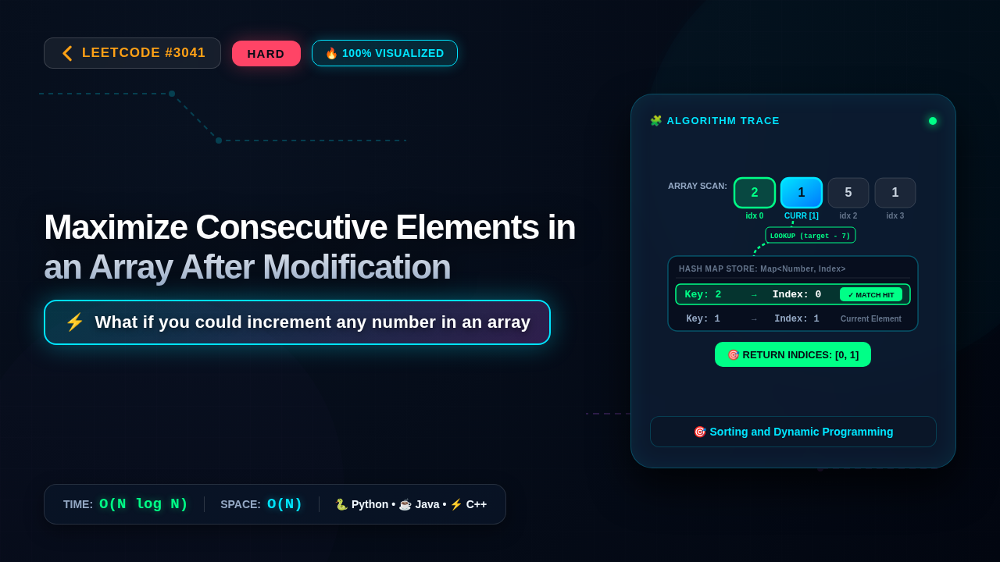

# 3041. Maximize Consecutive Elements in an Array After Modification

### 📺 Video Walkthrough & Visual Execution

👉 **[Watch the complete step-by-step visual explanation on YouTube](https://www.youtube.com/watch?v=WdIpeL06t5U)**

📂 **YouTube Playlist:** [Hard LeetCode Problems Playlist](https://www.youtube.com/playlist?list=PLWnvKaA3LMvs)

## 💻 Solutions in 5 Major Languages

| Language | Solution File |
|---|---|
| 🐍 **Python 3** | [`solution.py`](solution.py) |
| ☕ **Java** | [`Solution.java`](Solution.java) |
| ⚡ **C++** | [`solution.cpp`](solution.cpp) |
| 🟨 **JavaScript** | [`solution.js`](solution.js) |
| 🐹 **Go** | [`solution.go`](solution.go) |

## 📝 Problem Statement

You are given a 
0-indexed
 array 
nums
 consisting of 
positive
 integers.

Initially, you can increase the value of 
any
 element in the array by 
at most
 
1
.

After that, you need to select 
one or more
 elements from the final array such that those elements are 
consecutive
 when sorted in increasing order. For example, the elements 
[3, 4, 5]
 are consecutive while 
[3, 4, 6]
 and 
[1, 1, 2, 3]
 are not.

Return 
the 
maximum
 number of elements that you can select
.

## 💡 Approach: Sorting and Dynamic Programming

To solve this problem, we first sort the array `nums` in non-decreasing order. Sorting allows us to process the numbers sequentially and greedily build consecutive sequences.

Let `dp[v]` be the maximum length of a consecutive sequence ending at integer `v`. For each number `x` in sorted `nums`, it can either remain as `x` or be incremented to `x + 1`:
1. If transformed to `x + 1`, it can extend a valid sequence ending at `x`. The length of this sequence becomes `dp[x] + 1`.
2. If kept as `x`, it can extend a valid sequence ending at `x - 1`. The length of this sequence becomes `dp[x - 1] + 1`.

To prevent using the same element `x` twice within the same state update (i.e. using it as `x` and then using that updated `dp[x]` to compute `dp[x + 1]`), we must update `dp[x + 1]` *before* updating `dp[x]`. Iterating through all sorted elements and keeping track of the global maximum sequence length yields the optimal solution.

## ⏱️ Complexity

- **Time Complexity:** `O(N log N)`
- **Space Complexity:** `O(N)`
