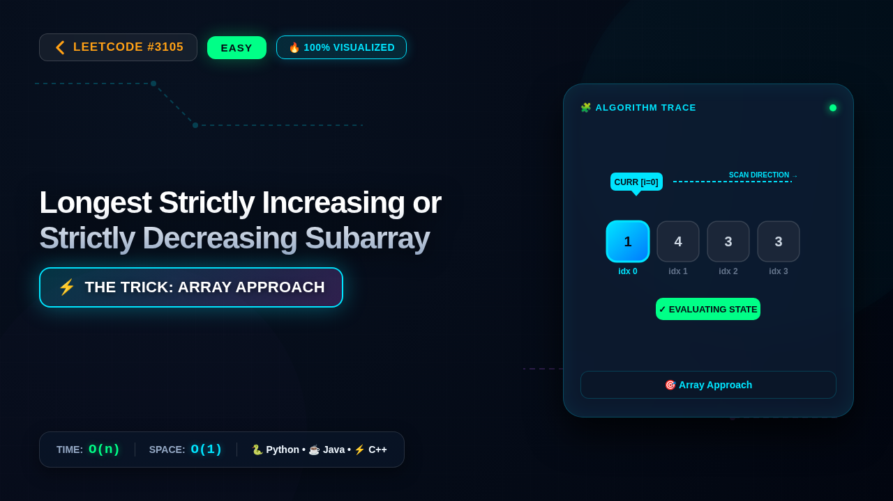

# 3105. Longest Strictly Increasing or Strictly Decreasing Subarray

### 📺 Video Walkthrough & Visual Execution

👉 **[Watch the complete step-by-step visual explanation on YouTube](https://www.youtube.com/watch?v=1bmHKRtjWLE)**

📂 **YouTube Playlist:** [Easy LeetCode Problems Playlist](https://www.youtube.com/playlist?list=PLO_wgoXxiqtY)

## 💻 Solutions in 5 Major Languages

| Language | Solution File |
|---|---|
| 🐍 **Python 3** | [`solution.py`](solution.py) |
| ☕ **Java** | [`Solution.java`](Solution.java) |
| ⚡ **C++** | [`solution.cpp`](solution.cpp) |
| 🟨 **JavaScript** | [`solution.js`](solution.js) |
| 🐹 **Go** | [`solution.go`](solution.go) |

## 📝 Problem Statement

You are given an array of integers 
nums
. Return 
the length of the 
longest
 
subarray
 of 
nums
 which is either 
strictly increasing
 or 
strictly decreasing
.

## 💡 Approach: Array Approach

This solution uses the Array Approach with time complexity O(n) and auxiliary space O(1). It achieves optimal performance by taking advantage of Array.

## ⏱️ Complexity

- **Time Complexity:** `O(n)`
- **Space Complexity:** `O(1)`
