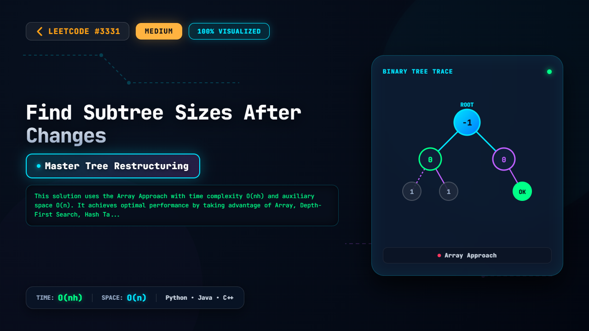

# 3331. Find Subtree Sizes After Changes

### 📺 Video Walkthrough & Visual Execution

👉 **[Watch the complete step-by-step visual explanation on YouTube](https://www.youtube.com/watch?v=zAKjEMvI1SE)**

📂 **YouTube Playlist:** [Medium LeetCode Problems Playlist](https://www.youtube.com/playlist?list=PLDwpLRpPSYZI)

## 💻 Solutions in 5 Major Languages

| Language | Solution File |
|---|---|
| 🐍 **Python 3** | [`solution.py`](solution.py) |
| ☕ **Java** | [`Solution.java`](Solution.java) |
| ⚡ **C++** | [`solution.cpp`](solution.cpp) |
| 🟨 **JavaScript** | [`solution.js`](solution.js) |
| 🐹 **Go** | [`solution.go`](solution.go) |

## 📝 Problem Statement

You are given a tree rooted at node 0 that consists of 
n
 nodes numbered from 
0
 to 
n - 1
. The tree is represented by an array 
parent
 of size 
n
, where 
parent[i]
 is the parent of node 
i
. Since node 0 is the root, 
parent[0] == -1
.

You are also given a string 
s
 of length 
n
, where 
s[i]
 is the character assigned to node 
i
.

We make the following changes on the tree 
one
 time 
simultaneously
 for all nodes 
x
 from 
1
 to 
n - 1
:

Find the 
closest
 node 
y
 to node 
x
 such that 
y
 is an ancestor of 
x
, and 
s[x] == s[y]
.

If node 
y
 does not exist, do nothing.

Otherwise, 
remove
 the edge between 
x
 and its current parent and make node 
y
 the new parent of 
x
 by adding an edge between them.

Return an array 
answer
 of size 
n
 where 
answer[i]
 is the 
size
 of the 
subtree
 rooted at node 
i
 in the 
final
 tree.

## 💡 Approach: Tree Re-parenting with DFS and Post-order Traversal

The problem requires us to find the size of each subtree after a specific re-parenting operation. The key challenge is that all changes happen simultaneously. This means we cannot simply iterate and modify the tree, as a change to one node's parent might affect the decision for another node that was supposed to be processed based on the original tree structure. The constraint `n <= 10` is extremely small, suggesting that even algorithms with higher polynomial complexity might pass, but a more efficient approach is still desirable.

First, we need to represent the tree in a way that allows easy traversal and modification. An adjacency list is suitable for this. Since the `parent` array defines the tree structure, we can build the adjacency list where `adj[i]` stores the children of node `i`.

The core of the problem lies in determining the new parent for each node `x` (from 1 to `n-1`). For each `x`, we need to find the closest ancestor `y` such that `s[x] == s[y]`. This search for an ancestor can be done efficiently by traversing upwards from `x` towards the root. However, since all changes are simultaneous, we must first determine all the new parent assignments based on the *original* tree structure before actually modifying the tree.

Let's define `new_parent[x]` as the potential new parent for node `x`. We can iterate through each node `x` from 1 to `n-1`. For each `x`, we traverse up its ancestors (using the original `parent` array) until we find an ancestor `y` where `s[x] == s[y]`. If such a `y` is found, we record `new_parent[x] = y`. If no such ancestor exists, `x` remains a child of its original parent, and `new_parent[x]` can be considered its original parent.

After determining all `new_parent` assignments, we construct the *final* tree structure. We can do this by creating a new adjacency list `final_adj` where `final_adj[p]` contains all nodes `c` such that `new_parent[c] == p`. Note that if `new_parent[x]` was not set (meaning `x`'s parent didn't change), its original parent is implicitly its parent in the final tree.

Finally, to calculate the subtree sizes in the final tree, we can use a Depth First Search (DFS) starting from the root (node 0). A post-order traversal is ideal for calculating subtree sizes. For a node `u`, its subtree size is 1 (for itself) plus the sum of the subtree sizes of all its children in the *final* tree. The DFS function would recursively call itself on each child, and upon returning, sum up the results and add 1.

This approach correctly handles the simultaneous nature of the changes by first determining all new parent relationships based on the original tree and then building the final tree structure before computing subtree sizes. The small constraint `n <= 10` makes this feasible, as the ancestor search for each node is at most O(n) and building the final tree and performing DFS are also efficient.

## ⏱️ Complexity

- **Time Complexity:** `O(N^2)`
- **Space Complexity:** `O(N)`
