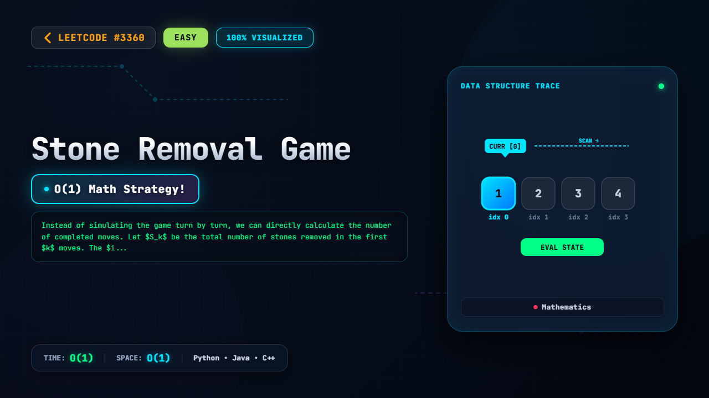

# 3360. Stone Removal Game

### Video Walkthrough & Visual Execution

**[Check out the full source code and multi-language solutions on our GitHub repository!](https://www.youtube.com/watch?v=lGCLV21W3J4)**

**YouTube Playlist:** [Easy LeetCode Problems Playlist](https://www.youtube.com/playlist?list=PLO_wgoXxiqtY)

## Solutions

| Language | Solution File |
|---|---|
| Python 3 | [`solution.py`](solution.py) |
| Java | [`Solution.java`](Solution.java) |
| C++ | [`solution.cpp`](solution.cpp) |
| JavaScript | [`solution.js`](solution.js) |
| Go | [`solution.go`](solution.go) |

## Problem Statement

Alice and Bob are playing a game where they take turns removing stones from a pile, with  Alice going first .

Alice starts by removing  exactly  10 stones on her first turn.

For each subsequent turn, each player removes  exactly  1 fewer   stone   than the previous opponent.

The player who cannot make a move loses the game.

Given a positive integer  n , return  true  if Alice wins the game and  false  otherwise.

## Approach: Mathematics

Instead of simulating the game turn by turn, we can directly calculate the number of completed moves. Let $S_k$ be the total number of stones removed in the first $k$ moves. The $i$-th move removes $11-i$ stones. Using the formula for the sum of an arithmetic progression, $$ S_k=10+9+\cdots+(11-k)=\frac{k\bigl(10+(11-k)\bigr)}{2}=\frac{k(21-k)}{2}, $$ where $S_0=0$. Since each turn removes at least $1$ stone, at most $10$ moves can be played in total ($S_{10}=55$). Furthermore, because $n\leq 50$, the game cannot complete $10$ moves, so we only need to consider $0\leq k\leq 9$. Within this ran

## Complexity

- **Time Complexity:** `O(1)`
- **Space Complexity:** `O(1)`
