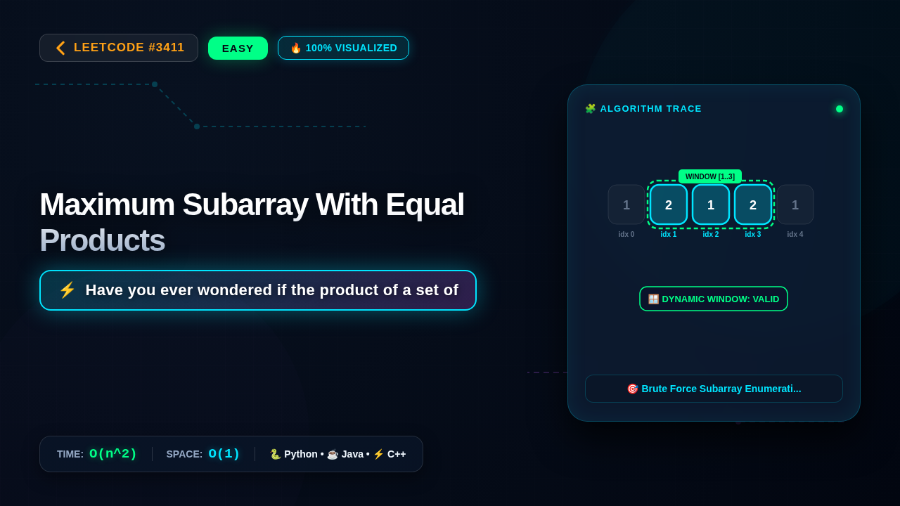

# 3411. Maximum Subarray With Equal Products

### 📺 Video Walkthrough & Visual Execution

👉 **[Watch the complete step-by-step visual explanation on YouTube](https://www.youtube.com/watch?v=jPIJWBw_qPo)**

📂 **YouTube Playlist:** [Easy LeetCode Problems Playlist](https://www.youtube.com/playlist?list=PLO_wgoXxiqtY)

## 💻 Solutions in 5 Major Languages

| Language | Solution File |
|---|---|
| 🐍 **Python 3** | [`solution.py`](solution.py) |
| ☕ **Java** | [`Solution.java`](Solution.java) |
| ⚡ **C++** | [`solution.cpp`](solution.cpp) |
| 🟨 **JavaScript** | [`solution.js`](solution.js) |
| 🐹 **Go** | [`solution.go`](solution.go) |

## 📝 Problem Statement

You are given an array of 
positive
 integers 
nums
.

An array 
arr
 is called 
product equivalent
 if 
prod(arr) == lcm(arr) * gcd(arr)
, where:

prod(arr)
 is the product of all elements of 
arr
.

gcd(arr)
 is the 
GCD
 of all elements of 
arr
.

lcm(arr)
 is the 
LCM
 of all elements of 
arr
.

Return the length of the 
longest
 
product equivalent
 
subarray
 of 
nums
.

## 💡 Approach: Brute Force Subarray Enumeration with Running GCD and LCM

Given the constraints where nums.length <= 100 and 1 <= nums[i] <= 10, we can iterate over all possible contiguous subarrays starting at index i and ending at index j. For each subarray, we incrementally update the product (prod), greatest common divisor (gcd), and least common multiple (lcm) of the current elements. At each step, we verify if prod == lcm * gcd. If the condition holds, we update the maximum length found so far.

## ⏱️ Complexity

- **Time Complexity:** `O(n^2)`
- **Space Complexity:** `O(1)`
