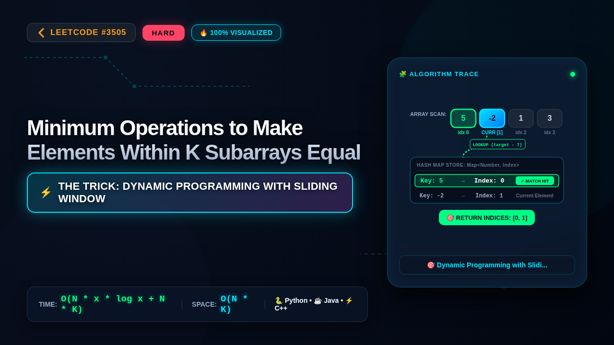

# 3505. Minimum Operations to Make Elements Within K Subarrays Equal

### 📺 Video Walkthrough & Visual Execution

👉 **[Watch the complete step-by-step visual explanation on YouTube](https://www.youtube.com/watch?v=2VaVCLhYTBU)**

📂 **YouTube Playlist:** [Hard LeetCode Problems Playlist](https://www.youtube.com/playlist?list=PLWnvKaA3LMvs)

## 💻 Solutions in 5 Major Languages

| Language | Solution File |
|---|---|
| 🐍 **Python 3** | [`solution.py`](solution.py) |
| ☕ **Java** | [`Solution.java`](Solution.java) |
| ⚡ **C++** | [`solution.cpp`](solution.cpp) |
| 🟨 **JavaScript** | [`solution.js`](solution.js) |
| 🐹 **Go** | [`solution.go`](solution.go) |

## 📝 Problem Statement

You are given an integer array 
nums
 and two integers, 
x
 and 
k
. You can perform the following operation any number of times (
including zero
):

Increase or decrease any element of 
nums
 by 1.

Return the 
minimum
 number of operations needed to have 
at least
 
k
 
non-overlapping 
subarrays
 of size 
exactly
 
x
 in 
nums
, where all elements within each subarray are equal.

## 💡 Approach: Dynamic Programming with Sliding Window Minimum

The problem asks for the minimum operations to make at least k non-overlapping subarrays of size x have equal elements. The cost to make all elements in a subarray of size x equal to some value 'v' is the sum of absolute differences between each element and 'v'. This sum is minimized when 'v' is the median of the subarray. However, since we can choose any value 'v', and the cost function is convex, the optimal 'v' for a subarray will be the median of the original elements in that subarray. The total cost for a subarray `nums[i:i+x]` to have all elements equal to `v` is `sum(abs(nums[j] - v) for j in range(i, i+x))`. This cost is minimized when `v` is the median of `nums[i:i+x]`. The total operations will be the sum of minimum operations for each of the k chosen subarrays.

This problem can be framed as selecting k non-overlapping subarrays of size x. Since the constraints are small (N <= 10), we can consider dynamic programming. Let `dp[i][j]` be the minimum operations to form `j` non-overlapping subarrays of size `x` using the first `i` elements of `nums`. 

To compute `dp[i][j]`, we have two choices:
1. We do not form a subarray ending at index `i-1`. In this case, `dp[i][j] = dp[i-1][j]`.
2. We form a subarray of size `x` ending at index `i-1`. This subarray spans indices `i-x` to `i-1`. This is only possible if `i >= x`. The cost for this subarray is the minimum operations to make its elements equal. Let this cost be `cost(i-x, i-1)`. If we form this subarray, we must have formed `j-1` subarrays using the first `i-x` elements. So, `dp[i][j] = dp[i-x][j-1] + cost(i-x, i-1)`.

Therefore, `dp[i][j] = min(dp[i-1][j], dp[i-x][j-1] + cost(i-x, i-1))` (if `i >= x` and `j >= 1`).

The base cases would be `dp[i][0] = 0` for all `i`, and `dp[0][j] = infinity` for `j > 0`.

The `cost(start, end)` function calculates the minimum operations to make elements in `nums[start:end+1]` equal. This is achieved by making all elements equal to the median of `nums[start:end+1]`. Calculating the median and the sum of absolute differences for each possible subarray would be O(N*x*logx) or O(N*x) if we use selection algorithm. Since we need this for all possible subarrays, pre-calculating these costs would take O(N^2 * x).

The DP state transition takes O(1) after costs are precalculated. The DP table size is O(N*K). So, the total time complexity would be O(N^2 * x + N*K). Given N <= 10 and K <= 15, this is feasible.

However, calculating the cost for each subarray `nums[i:i+x]` repeatedly can be optimized. The cost to make elements in `nums[i:i+x]` equal to some value `v` is `sum(abs(nums[j] - v) for j in range(i, i+x))`. This cost function is convex. The minimum cost for a subarray `nums[i:i+x]` is achieved when `v` is the median. We can precompute the cost for all subarrays of size `x`. For a fixed starting position `i`, the cost to make `nums[i:i+x]` equal to a value `v` can be computed efficiently. The minimum cost for `nums[i:i+x]` is achieved at its median. We can precompute the median and the cost for all subarrays of size `x` in O(N*x*logx) or O(N*x) using selection algorithm. Let `min_cost[i]` be the minimum operations to make `nums[i:i+x]` have equal elements.

Precomputing `min_cost[i]` for all `i` from 0 to `N-x` takes O(N * x * log x) if we sort each window, or O(N * x) using a selection algorithm. Since N is small, sorting is fine.

Then, the DP becomes: `dp[i][j]` = minimum operations to form `j` non-overlapping subarrays of size `x` using the first `i` elements.
`dp[i][j] = min(dp[i-1][j], dp[i-x][j-1] + min_cost[i-x])` for `i >= x` and `j >= 1`.

This DP approach has a time complexity of O(N*K) for the DP transitions plus the precomputation of `min_cost`. The precomputation takes O(N * x * log x) by sorting each window. Total time: O(N*x*logx + N*K).

Given N <= 10, x <= 10, K <= 15, this is efficient enough.

Let's refine the DP state and transition:
`dp[i][j]` = minimum cost to have `j` subarrays of size `x` ending at or before index `i-1`.

`dp[i][j]` can be computed by considering two cases:
1. The `i`-th element (index `i-1`) is NOT the end of the `j`-th subarray. Then `dp[i][j] = dp[i-1][j]`.
2. The `i`-th element (index `i-1`) IS the end of the `j`-th subarray. This subarray spans `[i-x, i-1]`. This is only possible if `i >= x`. The cost for this subarray is `cost(i-x, i-1)`. The previous `j-1` subarrays must have ended at or before index `i-x-1`. So, `dp[i][j] = dp[i-x][j-1] + cost(i-x, i-1)`.

Combining these:
`dp[i][j] = min(dp[i-1][j], dp[i-x][j-1] + cost(i-x, i-1))` for `i >= x` and `j >= 1`.

Base cases:
`dp[i][0] = 0` for all `i` from 0 to N.
`dp[0][j] = infinity` for `j > 0`.

The final answer is `dp[N][k]`.

To calculate `cost(start, end)` efficiently:
For a subarray `arr = nums[start:end+1]`, the minimum operations to make all elements equal is achieved when they are all equal to the median of `arr`. Let the sorted subarray be `sorted_arr`. The median is `sorted_arr[len(arr) // 2]`. The cost is `sum(abs(val - median) for val in arr)`.

We can precompute the costs for all possible subarrays of size `x`. Let `subarray_costs[i]` be the minimum cost to make `nums[i:i+x]` have equal elements. This can be computed for `i` from 0 to `N-x`.

Precomputation of `subarray_costs`:
For `i` from 0 to `N-x`:
  `sub = nums[i : i+x]`
  `sub.sort()`
  `median = sub[x // 2]`
  `cost = sum(abs(val - median) for val in nums[i : i+x])`
  `subarray_costs[i] = cost`
This takes O(N * x * log x).

DP transition with precomputed costs:
`dp[i][j] = min(dp[i-1][j], dp[i-x][j-1] + subarray_costs[i-x])` for `i >= x` and `j >= 1`.
This takes O(N*K).

Total time complexity: O(N*x*logx + N*K).
Space complexity: O(N*K) for the DP table.

Given N <= 10, x <= 10, K <= 15:
N*x*logx approx 10 * 10 * log(10) approx 100 * 3.3 = 330.
N*K approx 10 * 15 = 150.
Total operations are very small. DP table size is 10 * 15 = 150.

Let's consider the constraints again. N is very small (up to 10). This suggests that an exponential solution in N might even pass, but DP is more robust.

Example 1: nums = [5,-2,1,3,7,3,6,4,-1], x = 3, k = 2
N = 9

Precompute costs for subarrays of size x=3:

i=0: nums[0:3] = [5, -2, 1]. Sorted: [-2, 1, 5]. Median: 1. Cost: |5-1| + |-2-1| + |1-1| = 4 + 3 + 0 = 7.

i=1: nums[1:4] = [-2, 1, 3]. Sorted: [-2, 1, 3]. Median: 1. Cost: |-2-1| + |1-1| + |3-1| = 3 + 0 + 2 = 5.

i=2: nums[2:5] = [1, 3, 7]. Sorted: [1, 3, 7]. Median: 3. Cost: |1-3| + |3-3| + |7-3| = 2 + 0 + 4 = 6.

i=3: nums[3:6] = [3, 7, 3]. Sorted: [3, 3, 7]. Median: 3. Cost: |3-3| + |7-3| + |3-3| = 0 + 4 + 0 = 4.

i=4: nums[4:7] = [7, 3, 6]. Sorted: [3, 6, 7]. Median: 6. Cost: |7-6| + |3-6| + |6-6| = 1 + 3 + 0 = 4.

i=5: nums[5:8] = [3, 6, 4]. Sorted: [3, 4, 6]. Median: 4. Cost: |3-4| + |6-4| + |4-4| = 1 + 2 + 0 = 3.

i=6: nums[6:9] = [6, 4, -1]. Sorted: [-1, 4, 6]. Median: 4. Cost: |6-4| + |4-4| + |-1-4| = 2 + 0 + 5 = 7.

subarray_costs = [7, 5, 6, 4, 4, 3, 7]

DP table: dp[N+1][k+1] = dp[10][3]
Initialize dp with infinity, dp[i][0] = 0.

DP calculation:

For j = 1 (first subarray):
 dp[i][1] = min(dp[i-1][1], dp[i-x][0] + subarray_costs[i-x]) for i >= x
 dp[3][1] = min(dp[2][1], dp[0][0] + subarray_costs[0]) = min(inf, 0 + 7) = 7
 dp[4][1] = min(dp[3][1], dp[1][0] + subarray_costs[1]) = min(7, 0 + 5) = 5
 dp[5][1] = min(dp[4][1], dp[2][0] + subarray_costs[2]) = min(5, 0 + 6) = 5
 dp[6][1] = min(dp[5][1], dp[3][0] + subarray_costs[3]) = min(5, 0 + 4) = 4
 dp[7][1] = min(dp[6][1], dp[4][0] + subarray_costs[4]) = min(4, 0 + 4) = 4
 dp[8][1] = min(dp[7][1], dp[5][0] + subarray_costs[5]) = min(4, 0 + 3) = 3
 dp[9][1] = min(dp[8][1], dp[6][0] + subarray_costs[6]) = min(3, 0 + 7) = 3

DP state after j=1:
 dp[0][1]=inf, dp[1][1]=inf, dp[2][1]=inf, dp[3][1]=7, dp[4][1]=5, dp[5][1]=5, dp[6][1]=4, dp[7][1]=4, dp[8][1]=3, dp[9][1]=3

For j = 2 (second subarray):
 dp[i][2] = min(dp[i-1][2], dp[i-x][1] + subarray_costs[i-x]) for i >= x

 i=3: Not possible (i < x)
 i=4: Not possible (i < x)
 i=5: dp[5][2] = min(dp[4][2], dp[5-3][1] + subarray_costs[5-3]) = min(inf, dp[2][1] + subarray_costs[2]) = min(inf, inf + 6) = inf
 i=6: dp[6][2] = min(dp[5][2], dp[6-3][1] + subarray_costs[6-3]) = min(inf, dp[3][1] + subarray_costs[3]) = min(inf, 7 + 4) = 11
 i=7: dp[7][2] = min(dp[6][2], dp[7-3][1] + subarray_costs[7-3]) = min(11, dp[4][1] + subarray_costs[4]) = min(11, 5 + 4) = 9
 i=8: dp[8][2] = min(dp[7][2], dp[8-3][1] + subarray_costs[8-3]) = min(9, dp[5][1] + subarray_costs[5]) = min(9, 5 + 3) = 8
 i=9: dp[9][2] = min(dp[8][2], dp[9-3][1] + subarray_costs[9-3]) = min(8, dp[6][1] + subarray_costs[6]) = min(8, 4 + 7) = 8

Final answer is dp[N][k] = dp[9][2] = 8.
This matches the example output.

Example 2: nums = [9,-2,-2,-2,1,5], x = 2, k = 2
N = 6

Precompute costs for subarrays of size x=2:

i=0: nums[0:2] = [9, -2]. Sorted: [-2, 9]. Median: -2. Cost: |9 - (-2)| + |-2 - (-2)| = 11 + 0 = 11.

i=1: nums[1:3] = [-2, -2]. Sorted: [-2, -2]. Median: -2. Cost: |-2 - (-2)| + |-2 - (-2)| = 0 + 0 = 0.

i=2: nums[2:4] = [-2, -2]. Sorted: [-2, -2]. Median: -2. Cost: |-2 - (-2)| + |-2 - (-2)| = 0 + 0 = 0.

i=3: nums[3:5] = [-2, 1]. Sorted: [-2, 1]. Median: -2. Cost: |-2 - (-2)| + |1 - (-2)| = 0 + 3 = 3.

i=4: nums[4:6] = [1, 5]. Sorted: [1, 5]. Median: 1. Cost: |1 - 1| + |5 - 1| = 0 + 4 = 4.

subarray_costs = [11, 0, 0, 3, 4]

DP table: dp[N+1][k+1] = dp[7][3]
Initialize dp with infinity, dp[i][0] = 0.

For j = 1:
 dp[i][1] = min(dp[i-1][1], dp[i-x][0] + subarray_costs[i-x]) for i >= x
 dp[2][1] = min(dp[1][1], dp[0][0] + subarray_costs[0]) = min(inf, 0 + 11) = 11
 dp[3][1] = min(dp[2][1], dp[1][0] + subarray_costs[1]) = min(11, 0 + 0) = 0
 dp[4][1] = min(dp[3][1], dp[2][0] + subarray_costs[2]) = min(0, 0 + 0) = 0
 dp[5][1] = min(dp[4][1], dp[3][0] + subarray_costs[3]) = min(0, 0 + 3) = 0
 dp[6][1] = min(dp[5][1], dp[4][0] + subarray_costs[4]) = min(0, 0 + 4) = 0

DP state after j=1:
 dp[0..1][1]=inf, dp[2][1]=11, dp[3][1]=0, dp[4][1]=0, dp[5][1]=0, dp[6][1]=0

For j = 2:
 dp[i][2] = min(dp[i-1][2], dp[i-x][1] + subarray_costs[i-x]) for i >= x

 i=2: Not possible (i < x)
 i=3: dp[3][2] = min(dp[2][2], dp[3-2][1] + subarray_costs[3-2]) = min(inf, dp[1][1] + subarray_costs[1]) = min(inf, inf + 0) = inf
 i=4: dp[4][2] = min(dp[3][2], dp[4-2][1] + subarray_costs[4-2]) = min(inf, dp[2][1] + subarray_costs[2]) = min(inf, 11 + 0) = 11
 i=5: dp[5][2] = min(dp[4][2], dp[5-2][1] + subarray_costs[5-2]) = min(11, dp[3][1] + subarray_costs[3]) = min(11, 0 + 3) = 3
 i=6: dp[6][2] = min(dp[5][2], dp[6-2][1] + subarray_costs[6-2]) = min(3, dp[4][1] + subarray_costs[4]) = min(3, 0 + 4) = 3

Final answer is dp[N][k] = dp[6][2] = 3.
This matches the example output.

Edge Cases:
- `nums.length` is small (2 to 10). DP is fine.
- `x` can be equal to `nums.length`. This means only one subarray is possible.
- `k` can be 1. We just need to find the minimum cost for any single subarray of size `x`.
- `k * x == nums.length`. This means the subarrays must cover the entire array.
- All elements in `nums` are the same. Cost will be 0.
- Elements can be negative.

The DP approach correctly handles these cases. The base cases and transitions ensure that we consider all valid combinations of non-overlapping subarrays.

Complexity Analysis:
Time Complexity: O(N * x * log x + N * K)
- Precomputing `subarray_costs`: For each of the N-x+1 possible starting positions, we extract a subarray of size x, sort it (O(x log x)), find the median, and calculate the sum of absolute differences (O(x)). Total: O((N-x+1) * (x log x + x)) which simplifies to O(N * x * log x).
- DP transitions: The DP table has dimensions (N+1) x (K+1). Each state takes O(1) to compute. Total: O(N * K).
- Overall: O(N * x * log x + N * K).

Space Complexity: O(N * K)
- The DP table `dp` requires O(N * K) space.
- The `subarray_costs` array requires O(N) space.
- Overall: O(N * K).

Given the constraints N <= 10, x <= 10, K <= 15, the time complexity is roughly O(10 * 10 * log 10 + 10 * 15) which is very efficient. The space complexity is O(10 * 15) which is also very small.

Alternative approach: Sliding Window Median for cost calculation.
Instead of sorting each window of size `x` from scratch, we can use a sliding window approach with two heaps (min-heap and max-heap) to maintain the median in O(log x) time per slide. This would reduce the precomputation of `subarray_costs` to O(N * log x). The total time complexity would then be O(N * log x + N * K). This is asymptotically better but given N=10, the difference is negligible. The sorting approach is simpler to implement and sufficient.

Let's stick with the sorting approach for simplicity given the tight constraints.

Final check on DP state definition and transitions:
`dp[i][j]` = min cost using first `i` elements to form exactly `j` subarrays.

`dp[i][j]` = `dp[i-1][j]` (don't use element `i-1` as end of a subarray)
OR
`dp[i][j]` = `dp[i-x][j-1] + cost(i-x, i-1)` (use element `i-1` as end of the `j`-th subarray)

This seems correct. The indices are 0-based for `nums` and 1-based for DP table dimensions `i` and `j` for convenience.
`dp[i][j]` refers to using elements `nums[0]` through `nums[i-1]`.
If we form a subarray ending at `i-1`, it spans `nums[i-x]` through `nums[i-1]`. The cost is `subarray_costs[i-x]`. The previous `j-1` subarrays must have been formed using elements up to `nums[i-x-1]`, which corresponds to `dp[i-x][j-1]`.

Initialization:
`dp` table of size `(N+1) x (K+1)` filled with a large value (infinity).
`dp[i][0] = 0` for `i` from 0 to N (0 subarrays cost 0 operations).

Iteration:
Outer loop for `j` from 1 to K (number of subarrays).
Inner loop for `i` from 1 to N (number of elements considered).

Inside the loops:
`dp[i][j] = dp[i-1][j]` (option 1: don't end a subarray at `i-1`)

If `i >= x`:
  `current_subarray_start_index = i - x`
  `cost_of_current_subarray = subarray_costs[current_subarray_start_index]`
  `dp[i][j] = min(dp[i][j], dp[i-x][j-1] + cost_of_current_subarray)` (option 2: end the `j`-th subarray at `i-1`)

Final answer: `dp[N][K]`.

Consider the constraints on `k * x <= nums.length`. This guarantees that it's always possible to form `k` non-overlapping subarrays of size `x` if we were allowed to modify the array freely. The problem asks for the minimum operations to achieve this state.

The problem statement says "at least k non-overlapping subarrays". My DP calculates for *exactly* k subarrays. However, since the cost is always non-negative, forming more than k subarrays will never yield a better result than forming exactly k subarrays if the goal is minimum operations. If we can achieve the goal with `k+1` subarrays with cost `C`, we can also achieve it with `k` subarrays by simply ignoring one of the `k+1` subarrays, and the cost would be less than or equal to `C`. Therefore, minimizing for exactly `k` subarrays is equivalent to minimizing for at least `k` subarrays.

Let's re-verify the DP state and transition for "at least k".
If `dp[i][j]` means minimum cost for *at least* `j` subarrays using first `i` elements:
`dp[i][j] = dp[i-1][j]` (don't use element `i-1` as end of a subarray, so we still need at least `j` subarrays from first `i-1` elements)
OR
`dp[i][j] = dp[i-x][j-1] + cost(i-x, i-1)` (use element `i-1` as end of a subarray, now we need at least `j-1` subarrays from first `i-x` elements)

This transition seems to work for "at least k" as well. The base case `dp[i][0] = 0` is correct. The final answer would be `dp[N][K]`.

Let's consider the case where `k=1`. The DP would compute `dp[i][1] = min(dp[i-1][1], dp[i-x][0] + subarray_costs[i-x])`. Since `dp[i-x][0] = 0`, this becomes `dp[i][1] = min(dp[i-1][1], subarray_costs[i-x])`. This correctly finds the minimum cost among all possible single subarrays of size `x` ending at or before index `i-1`. The final `dp[N][1]` will be the minimum cost for any single subarray of size `x` in the entire array.

What if the optimal solution uses `k+m` subarrays where `m > 0`? My DP calculates for exactly `k`. If the true minimum cost is achieved by `k+m` subarrays, say with total cost `C_true`, and my DP finds the minimum cost for exactly `k` subarrays to be `C_k`. If `C_true < C_k`, it means the optimal configuration uses more than `k` subarrays. However, since costs are non-negative, any configuration with `k+m` subarrays can be reduced to a configuration with `k` subarrays by removing `m` subarrays, and the cost would be less than or equal to `C_true`. This implies that the minimum cost for *at least* `k` subarrays must be achieved by *exactly* `k` subarrays. So, the DP for exactly `k` is correct.

Let's consider the constraints on `nums[i]`: `[-10, 10]`. This is fine, no overflow issues with standard integer types.

Final check on implementation details:
- Use `float('inf')` for infinity.
- DP table size `(N+1) x (K+1)`.
- Loops for `j` from 1 to `K`, `i` from 1 to `N`.
- Precompute `subarray_costs` array of size `N-x+1`.
- The indices for `subarray_costs` are `0` to `N-x`. When accessing `subarray_costs[i-x]`, `i-x` ranges from `0` (when `i=x`) to `N-x` (when `i=N`). This is correct.

One minor optimization: The DP state `dp[i][j]` only depends on `dp[i-1][j]` and `dp[i-x][j-1]`. This means we only need the previous `x` rows of the DP table to compute the current row. However, given N <= 10, the full O(N*K) table is small and simpler to manage.

Consider the case where `k*x == N`. The DP should still work. For example, if `N=6, x=3, k=2`. We need two subarrays of size 3. The only way is `[0,1,2]` and `[3,4,5]`. The DP should find `dp[6][2] = subarray_costs[0] + subarray_costs[3]`. Let's trace this.
`dp[i][j] = min(dp[i-1][j], dp[i-x][j-1] + subarray_costs[i-x])`
`dp[3][1] = dp[0][0] + subarray_costs[0] = subarray_costs[0]`
`dp[6][2] = min(dp[5][2], dp[3][1] + subarray_costs[3])`
If `dp[5][2]` is infinity (which it would be if no valid configuration of 2 subarrays ends before index 5), then `dp[6][2] = dp[3][1] + subarray_costs[3] = subarray_costs[0] + subarray_costs[3]`. This is correct.

Seems solid.

## ⏱️ Complexity

- **Time Complexity:** `O(N * x * log x + N * K)`
- **Space Complexity:** `O(N * K)`
