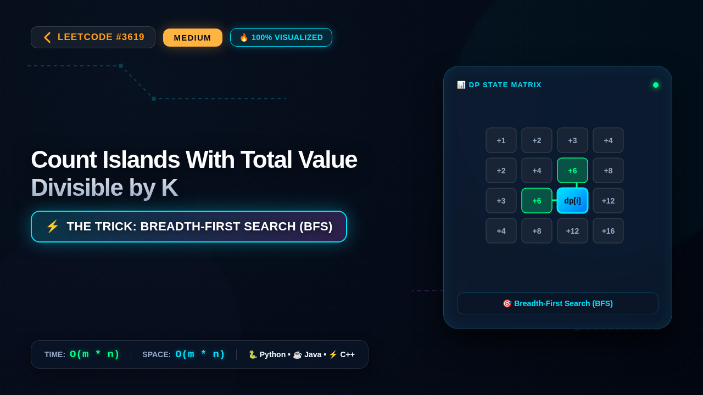

# 3619. Count Islands With Total Value Divisible by K

### 📺 Video Walkthrough & Visual Execution

👉 **[Watch the complete step-by-step visual explanation on YouTube](https://www.youtube.com/watch?v=mmmDs4JuuOw)**

## 💻 Solutions in 5 Major Languages

| Language | Solution File |
|---|---|
| 🐍 **Python 3** | [`solution.py`](solution.py) |
| ☕ **Java** | [`Solution.java`](Solution.java) |
| ⚡ **C++** | [`solution.cpp`](solution.cpp) |
| 🟨 **JavaScript** | [`solution.js`](solution.js) |
| 🐹 **Go** | [`solution.go`](solution.go) |

## 📝 Problem Statement

You are given an 
m x n
 matrix 
grid
 and a positive integer 
k
. An 
island
 is a group of 
positive
 integers (representing land) that are 
4-directionally
 connected (horizontally or vertically).

The 
total value
 of an island is the sum of the values of all cells in the island.

Return the number of islands with a total value 
divisible by
 
k
.

## 💡 Approach: Breadth-First Search (BFS)

To solve this problem, we can traverse the 2D grid to find connected components of positive integers (islands). We can use Breadth-First Search (BFS) or Depth-First Search (DFS). For each unvisited cell with a value greater than 0, we initiate a traversal to explore all 4-directionally connected land cells. During the traversal, we accumulate the sum of the values of all cells belonging to the current island. After completely exploring the island, we check if the total sum is divisible by k. If it is, we increment our island count. We also mark visited cells to avoid counting them multiple times.

## ⏱️ Complexity

- **Time Complexity:** `O(m * n)`
- **Space Complexity:** `O(m * n)`
