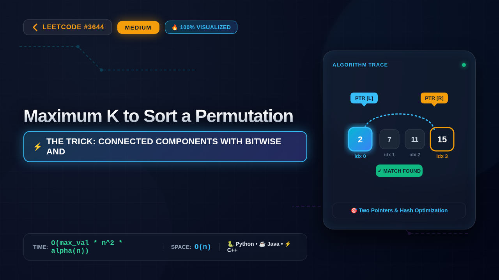

# 3644. Maximum K to Sort a Permutation

### 📺 Video Walkthrough & Visual Execution

👉 **[Watch the complete step-by-step visual explanation on YouTube](https://www.youtube.com/watch?v=JOJrDWqGLTA)**

## 💻 Solutions in 5 Major Languages

| Language | Solution File |
|---|---|
| 🐍 **Python 3** | [`solution.py`](solution.py) |
| ☕ **Java** | [`Solution.java`](Solution.java) |
| ⚡ **C++** | [`solution.cpp`](solution.cpp) |
| 🟨 **JavaScript** | [`solution.js`](solution.js) |
| 🐹 **Go** | [`solution.go`](solution.go) |

## 📝 Problem Statement

You are given an integer array 
nums
 of length 
n
, where 
nums
 is a 
permutation
 of the numbers in the range 
[0..n - 1]
.

You may swap elements at indices 
i
 and 
j
 
only if
 
nums[i] AND nums[j] == k
, where 
AND
 denotes the bitwise AND operation and 
k
 is a 
non-negative
 integer.

Return the 
maximum
 value of 
k
 such that the array can be sorted in 
non-decreasing
 order using any number of such swaps. If 
nums
 is already sorted, return 0.

## 💡 Approach: Connected Components with Bitwise AND

To sort the permutation, we can think of the problem as a graph where each number is a node, and an edge exists between two nodes if we can swap them. We can swap two elements nums[i] and nums[j] if (nums[i] & nums[j]) == k. This implies that for a given k, elements can be swapped freely if their bitwise AND is at least k, or more precisely, if they share all bits of k. However, the condition states nums[i] & nums[j] == k. This means k must be a bitmask subset of both nums[i] and nums[j]. Since we want to maximize k, and k must allow us to sort the array, k should be a common bitmask of the connected components of misplaced elements. In fact, if we want to sort the array, any element that needs to move to its correct sorted position (index i should hold value i) must be able to reach that position through a sequence of valid swaps. This forms connected components. For a set of indices that need to be swapped among themselves, any valid k must be a common bitmask of all elements involved in these misplaced cycles. To find the maximum k, we can consider the bitwise AND of all pairs or rather, since any k that works must satisfy that for all elements that are misplaced, their values when bitwise AND-ed with k must form cycles that can resolve the permutation. Alternatively, any valid k must be a subset of the bitwise AND of all elements in each disjoint cycle of misplaced elements. Maximizing k means we can take the bitwise OR of all possible valid k values, or since k is a single value, we check candidate values of k from high to low, or compute the bitwise AND of elements that need to be swapped. Since n is very small (n <= 10), we can iterate over all possible values of k from the maximum possible down to 0, and for each k, check if we can sort the array by building a graph where edges exist if (nums[i] & nums[j]) == k (or more generally, if they can be connected via elements whose AND is k). Wait, the problem says 'nums[i] AND nums[j] == k'. This means the edge weight is exactly k. But we can make multiple swaps. If we can swap i and j when their AND is k, then k must be a subset of both. Actually, if two elements have AND equal to k, then both numbers have all the bits of k set. This means any swap operation requires that the two numbers have k as a common submask. Thus, any element in a connected component of swaps must have k as a subset of its binary representation. Therefore, k must be a bitwise AND of all elements in that component. Since we want the maximum k, and the constraints are very small (n <= 10), we can check all possible values of k from (2^n - 1) down to 0. For a fixed k, we check if all elements nums[i] != i have k as a submask (i.e., (nums[i] & k) == k), and furthermore, whether the components formed by edges where (nums[i] & nums[j]) == k (or simply connected components of elements having k as a submask) can sort the array. Even simpler: since n <= 10, we can just test all k from largest to smallest. If nums is already sorted, return 0.

## ⏱️ Complexity

- **Time Complexity:** `O(max_val * n^2 * alpha(n))`
- **Space Complexity:** `O(n)`
