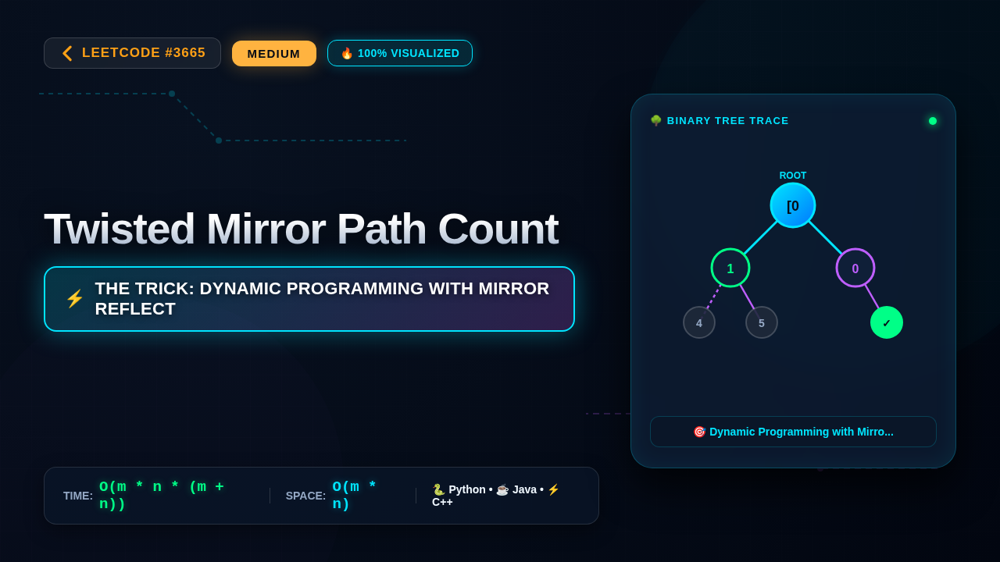

# 3665. Twisted Mirror Path Count

### 📺 Video Walkthrough & Visual Execution

👉 **[Watch the complete step-by-step visual explanation on YouTube](https://www.youtube.com/watch?v=TrW_QgmLzTE)**

📂 **YouTube Playlist:** [Medium LeetCode Problems Playlist](https://www.youtube.com/playlist?list=PLDwpLRpPSYZI)

## 💻 Solutions in 5 Major Languages

| Language | Solution File |
|---|---|
| 🐍 **Python 3** | [`solution.py`](solution.py) |
| ☕ **Java** | [`Solution.java`](Solution.java) |
| ⚡ **C++** | [`solution.cpp`](solution.cpp) |
| 🟨 **JavaScript** | [`solution.js`](solution.js) |
| 🐹 **Go** | [`solution.go`](solution.go) |

## 📝 Problem Statement

Given an 
m x n
 binary grid 
grid
 where:

grid[i][j] == 0
 represents an empty cell, and

grid[i][j] == 1
 represents a mirror.

A robot starts at the top-left corner of the grid 
(0, 0)
 and wants to reach the bottom-right corner 
(m - 1, n - 1)
. It can move only 
right
 or 
down
. If the robot attempts to move into a mirror cell, it is 
reflected
 before entering that cell:

If it tries to move 
right
 into a mirror, it is turned 
down
 and moved into the cell directly below the mirror.

If it tries to move 
down
 into a mirror, it is turned 
right
 and moved into the cell directly to the right of the mirror.

If this reflection would cause the robot to move outside the 
grid
 boundaries, the path is considered invalid and should not be counted.

Return the number of unique valid paths from 
(0, 0)
 to 
(m - 1, n - 1)
.

Since the answer may be very large, return it 
modulo
 
10
9
 + 7
.

Note
: If a reflection moves the robot into a mirror cell, the robot is immediately reflected again based on the direction it used to enter that mirror: if it entered while moving right, it will be turned down; if it entered while moving down, it will be turned right. This process will continue until either the last cell is reached, the robot moves out of bounds or the robot moves to a non-mirror cell.

## 💡 Approach: Dynamic Programming with Mirror Reflection Simulation

The problem asks for the number of paths from (0, 0) to (m - 1, n - 1) in a grid containing mirrors (1) and empty spaces (0). Moving right or down into a mirror redirects the robot: moving right into a mirror sends it down to the cell below, and moving down into a mirror sends it right to the cell to the right. This chain reaction can continue if the new cell is also a mirror. We can use dynamic programming where dp[i][j] represents the number of valid ways to reach cell (i, j). To compute dp[i][j], we sum the ways coming from the top and from the left. For a transition from the cell above (i-1, j) going down, if (i, j) is a mirror, it reflects the robot to the right (i, j+1). For a transition from the left (i, j-1) going right, if (i, j) is a mirror, it reflects the robot down (i+1, j). We simulate the reflection chain recursively or iteratively to find the final landing cell and add the path count modulo 10^9 + 7.

## ⏱️ Complexity

- **Time Complexity:** `O(m * n * (m + n))`
- **Space Complexity:** `O(m * n)`
