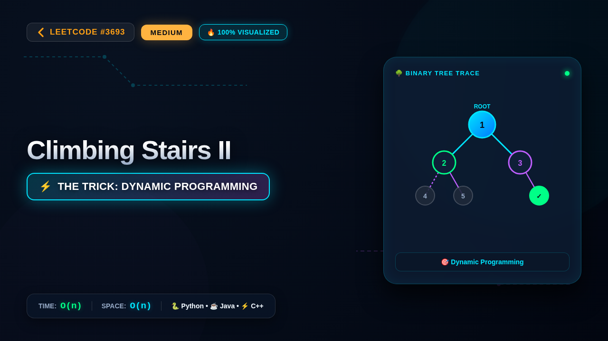

# 3693. Climbing Stairs II

### 📺 Video Walkthrough & Visual Execution

👉 **[Watch the complete step-by-step visual explanation on YouTube](https://www.youtube.com/watch?v=ICsuqeFwDwg)**

📂 **YouTube Playlist:** [Medium LeetCode Problems Playlist](https://www.youtube.com/playlist?list=PLDwpLRpPSYZI)

## 💻 Solutions in 5 Major Languages

| Language | Solution File |
|---|---|
| 🐍 **Python 3** | [`solution.py`](solution.py) |
| ☕ **Java** | [`Solution.java`](Solution.java) |
| ⚡ **C++** | [`solution.cpp`](solution.cpp) |
| 🟨 **JavaScript** | [`solution.js`](solution.js) |
| 🐹 **Go** | [`solution.go`](solution.go) |

## 📝 Problem Statement

You are climbing a staircase with 
n + 1
 steps, numbered from 0 to 
n
.

You are also given a 
1-indexed
 integer array 
costs
 of length 
n
, where 
costs[i]
 is the cost of step 
i
.

From step 
i
, you can jump 
only
 to step 
i + 1
, 
i + 2
, or 
i + 3
. The cost of jumping from step 
i
 to step 
j
 is defined as: 
costs[j] + (j - i)
2

You start from step 0 with 
cost = 0
.

Return the 
minimum
 total cost to reach step 
n
.

## 💡 Approach: Dynamic Programming

This problem can be solved using dynamic programming. We want to find the minimum cost to reach each step from step 0 up to step n. Let dp[i] be the minimum cost to reach step i. We start at step 0 with a cost of 0. To reach step i, we could have come from step i-1, i-2, or i-3. The cost to reach step i from step j (where j < i) is dp[j] + costs[i] + (i - j)^2. We need to consider all possible previous steps (i-1, i-2, i-3) and take the minimum cost. The base cases are: dp[0] = 0. For i > 0, dp[i] = min(dp[i-1] + costs[i] + (i-1)^2, dp[i-2] + costs[i] + (i-2)^2, dp[i-3] + costs[i] + (i-3)^2), where we only consider valid previous steps (i.e., i-k >= 0). The final answer will be dp[n].

The constraints on n (up to 10) are very small, which suggests that even a slightly less optimal DP approach would pass. However, the DP approach is the standard and most efficient way to solve this type of problem. The key insight is that the minimum cost to reach a step depends only on the minimum costs to reach the preceding few steps, forming a clear recursive structure suitable for DP.

## ⏱️ Complexity

- **Time Complexity:** `O(n)`
- **Space Complexity:** `O(n)`
