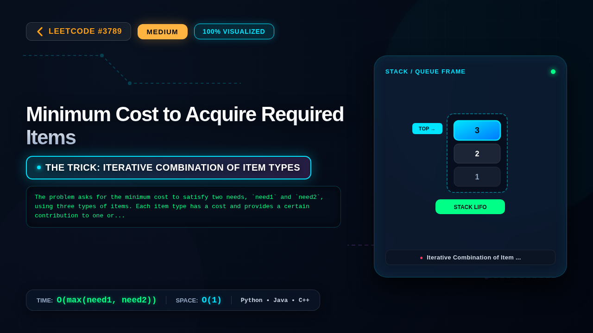

# 3789. Minimum Cost to Acquire Required Items

### 📺 Video Walkthrough & Visual Execution

👉 **[Watch the complete step-by-step visual explanation on YouTube](https://www.youtube.com/watch?v=Tpb0kTdnrHQ)**

📂 **YouTube Playlist:** [Medium LeetCode Problems Playlist](https://www.youtube.com/playlist?list=PLDwpLRpPSYZI)

## 💻 Solutions in 5 Major Languages

| Language | Solution File |
|---|---|
| 🐍 **Python 3** | [`solution.py`](solution.py) |
| ☕ **Java** | [`Solution.java`](Solution.java) |
| ⚡ **C++** | [`solution.cpp`](solution.cpp) |
| 🟨 **JavaScript** | [`solution.js`](solution.js) |
| 🐹 **Go** | [`solution.go`](solution.go) |

## 📝 Problem Statement

You are given five integers 
cost1
, 
cost2
, 
costBoth
, 
need1
, and 
need2
.

There are three types of items available:

An item of 
type 1
 costs 
cost1
 and contributes 1 unit to the type 1 requirement only.

An item of 
type 2
 costs 
cost2
 and contributes 1 unit to the type 2 requirement only.

An item of 
type 3
 costs 
costBoth
 and contributes 1 unit to 
both
 type 1 and type 2 requirements.

You must collect enough items so that the total contribution toward type 1 is 
at least
 
need1
 and the total contribution toward type 2 is 
at least
 
need2
.

Return an integer representing the 
minimum
 possible total cost to achieve these requirements.

## 💡 Approach: Iterative Combination of Item Types

The problem asks for the minimum cost to satisfy two needs, `need1` and `need2`, using three types of items. Each item type has a cost and provides a certain contribution to one or both needs. Since the costs and needs are relatively small (up to 10 for costs and needs), we can explore different combinations of using the 'type 3' item (which satisfies both needs) and then fulfilling the remaining requirements with 'type 1' and 'type 2' items.

The core idea is to iterate through all possible numbers of 'type 3' items we could buy. Let's say we buy `i` items of type 3. These `i` items contribute `i` to `need1` and `i` to `need2`. The cost for these `i` items is `i * costBoth`.

After buying `i` items of type 3, we will have remaining requirements: `max(0, need1 - i)` for type 1 and `max(0, need2 - i)` for type 2. These remaining requirements must be fulfilled using only type 1 and type 2 items. The most cost-effective way to fulfill these remaining needs is to buy exactly the number of type 1 items needed and exactly the number of type 2 items needed. So, the cost for the remaining needs would be `max(0, need1 - i) * cost1 + max(0, need2 - i) * cost2`.

The total cost for a given `i` would be `i * costBoth + max(0, need1 - i) * cost1 + max(0, need2 - i) * cost2`.

We need to find the minimum total cost across all possible values of `i`. What are the possible values for `i`? Since buying more than `max(need1, need2)` items of type 3 doesn't help satisfy any *additional* requirement beyond what's already covered by `max(need1, need2)` items, we only need to consider `i` from 0 up to `max(need1, need2)`. If `need1` or `need2` is 0, we can still consider buying `costBoth` items if it's cheaper than buying individual items, so the upper bound should be at least `max(need1, need2)`. A safe upper bound for `i` is `max(need1, need2)`. If `need1` and `need2` are both 0, the loop will run for `i=0` and correctly return 0.

We initialize `min_cost` to a very large value and update it with the calculated total cost for each `i`. The final `min_cost` will be the answer.

This approach works because it systematically explores all sensible strategies: using `i` 'type 3' items and then filling the rest with individual items. The constraints are small enough that this brute-force over the number of 'type 3' items is efficient.

## ⏱️ Complexity

- **Time Complexity:** `O(max(need1, need2))`
- **Space Complexity:** `O(1)`
