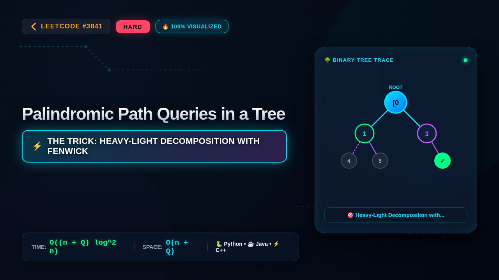

# 3841. Palindromic Path Queries in a Tree

### 📺 Video Walkthrough & Visual Execution

## 💻 Solutions in 5 Major Languages

| Language | Solution File |
|---|---|
| 🐍 **Python 3** | [`solution.py`](solution.py) |
| ☕ **Java** | [`Solution.java`](Solution.java) |
| ⚡ **C++** | [`solution.cpp`](solution.cpp) |
| 🟨 **JavaScript** | [`solution.js`](solution.js) |
| 🐹 **Go** | [`solution.go`](solution.go) |

## 📝 Problem Statement

You are given an undirected tree with 
n
 nodes labeled 0 to 
n - 1
. This is represented by a 2D array 
edges
 of length 
n - 1
, where 
edges[i] = [u
i
, v
i
]
 indicates an undirected edge between nodes 
u
i
 and 
v
i
.

You are also given a string 
s
 of length 
n
 consisting of lowercase English letters, where 
s[i]
 represents the character assigned to node 
i
.

You are also given a string array 
queries
, where each 
queries[i]
 is either:

"update u
i
 c"
: Change the character at node 
u
i
 to 
c
. Formally, update 
s[u
i
] = c
.

"query u
i
 v
i
"
: Determine whether the string formed by the characters on the 
unique
 path from 
u
i
 to 
v
i
 (inclusive) can be 
rearranged
 into a 
palindrome
.

Return a boolean array 
answer
, where 
answer[j]
 is 
true
 if the 
j
th
 query of type 
"query u
i
 v
i
"​​​​​​​
 can be rearranged into a 
palindrome
, and 
false
 otherwise.

## 💡 Approach: Heavy-Light Decomposition with Fenwick Tree or Segment Tree

To solve this problem efficiently, we represent characters 'a' through 't' (or 'a' through 'z') as bit masks where the i-th bit is set if the character's count is odd. A path string can be rearranged into a palindrome if and only if the bitwise XOR sum of all character masks along the path has at most one bit set (i.e., `(val & (val - 1)) == 0`). Since we need to support point updates and path queries on a tree, we can use Heavy-Light Decomposition (HLD) combined with a Segment Tree or Fenwick Tree to maintain the prefix XOR paths from the root. For any path from u to v, the character mask of the path is given by `xor_path(root, u) ^ xor_path(root, v) ^ mask(LCA(u, v))`. When a node's character is updated, it affects the subtree in terms of the prefix XORs. Using HLD, subtree updates become range updates, which can be efficiently handled using a lazy segment tree.

## ⏱️ Complexity

- **Time Complexity:** `O((n + Q) log^2 n)`
- **Space Complexity:** `O(n + Q)`
