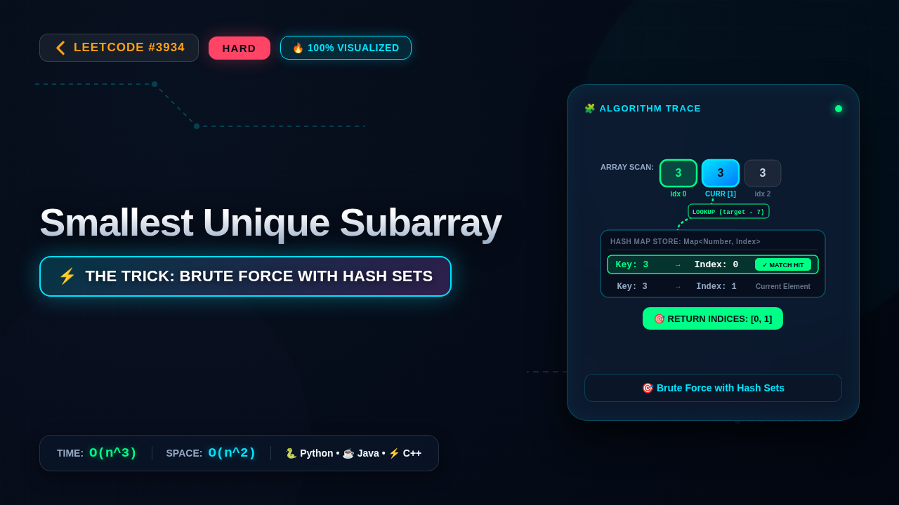

# 3934. Smallest Unique Subarray

### 📺 Video Walkthrough & Visual Execution

👉 **[Watch the complete step-by-step visual explanation on YouTube](https://www.youtube.com/watch?v=Nbag1wvVhLw)**

📂 **YouTube Playlist:** [Hard LeetCode Problems Playlist](https://www.youtube.com/playlist?list=PLWnvKaA3LMvs)

## 💻 Solutions in 5 Major Languages

| Language | Solution File |
|---|---|
| 🐍 **Python 3** | [`solution.py`](solution.py) |
| ☕ **Java** | [`Solution.java`](Solution.java) |
| ⚡ **C++** | [`solution.cpp`](solution.cpp) |
| 🟨 **JavaScript** | [`solution.js`](solution.js) |
| 🐹 **Go** | [`solution.go`](solution.go) |

## 📝 Problem Statement

You are given an integer array 
nums
.

Find the 
minimum 
length of a 
subarray
 that is 
not
 
identical
 to any other 
subarray
 in 
nums
.

Return an integer denoting the 
minimum possible length
 of such a 
subarray
.

Two 
subarrays
 are considered identical if they have the same length and the same elements in corresponding positions.

## 💡 Approach: Brute Force with Hash Sets

Given the small constraint on the array length (n <= 10), a brute-force approach is optimal and efficient. The problem asks for the minimum length of a subarray that appears exactly once in the array. We can iterate through all possible subarray lengths from 1 to n. For each length L, we generate all subarrays of that length, store them in a set to identify unique ones, and count their occurrences. If any subarray of length L appears exactly once, we return L immediately. Since we check lengths in increasing order, the first unique length found is the minimum. The number of subarrays is O(n^2), and each subarray has length at most n, so the total time complexity is O(n^3), which is trivial for n <= 10.

## ⏱️ Complexity

- **Time Complexity:** `O(n^3)`
- **Space Complexity:** `O(n^2)`
