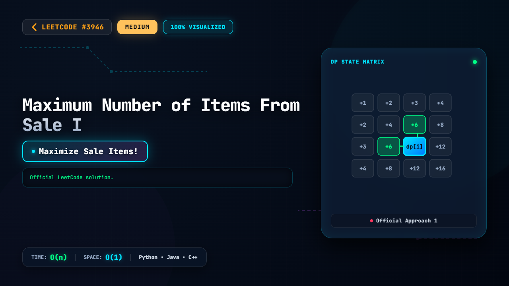

# 3946. Maximum Number of Items From Sale I

### Video Walkthrough & Visual Execution

**[Check out the repository for complete source code across Python, Java, C++, JavaScript, and Go!](https://www.youtube.com/watch?v=wLgY7MekbiE)**

**YouTube Playlist:** [Medium LeetCode Problems Playlist](https://www.youtube.com/playlist?list=PLDwpLRpPSYZI)

## Solutions

| Language | Solution File |
|---|---|
| Python 3 | [`solution.py`](solution.py) |
| Java | [`Solution.java`](Solution.java) |
| C++ | [`solution.cpp`](solution.cpp) |
| JavaScript | [`solution.js`](solution.js) |
| Go | [`solution.go`](solution.go) |

## Problem Statement

You are given a 2D integer array  items , where  items[i] = [factor_i, price_i]  represents the  i^th  item. You are also given an integer  budget .

There are unlimited copies of each item available for purchase.You may buy any number of copies of any items such that the total cost of the purchased copies is at most  budget .

After buying items, you may receive free copies according to the following rules:

For each item  i  that you bought  at least one copy  of, you receive  one free copy  of every item  j  such that  j != i  and  factor_i  divides  factor_j .

Buying multiple copies of the same item  i  does  not  give additional free copies through item  i .

The same item  j  can be received multiple times for free if it is received from purchases of different item types.

Return the  maximum total number of item copies  you can obtain, including both purchased copies and free copies, while spending at most  budget  on purchased items.

## Approach: Official Approach 1

Official LeetCode solution.

## Complexity

- **Time Complexity:** `O(n)`
- **Space Complexity:** `O(1)`
